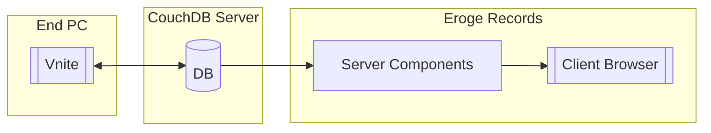

# Eroge Records

A personal Eroge play records tracking website

## Development

Use Node.js 24 LTS and pnpm 12.4.2 (pinned in `package.json`).

```sh
pnpm install --frozen-lockfile
pnpm run dev
pnpm run lint
pnpm run typecheck
pnpm run build
pnpm audit --prod
```

The app uses Next.js 16.4.2, React 19.3.1, HeroUI 3, and Tailwind CSS 4. HeroUI styles are imported in `src/app/globals.css`; components use the `@heroui/react/*` exports. Cache Components retain the previous prefetch behavior through `partialPrefetching: false`.

ESLint 9.39.5 and TypeScript 6.0.3 are the latest compatible versions as of October 23, 2026. The lint plugins used by `eslint-config-next` do not yet support ESLint 10 or TypeScript 7. The full dependency audit also reports an unpatched development-only [`braces` advisory](https://github.com/advisories/GHSA-vfj7-8cjw-p6xm) through Next.js's lint plugin; the production audit is clean. Recheck these constraints when upgrading the lint tooling.

## Overview

The main purpose of building this website is not the website itself, but rather I want to try out a complete workflow of building things with agents from the very beginning to the end.

That said, this project was about 70% percent written by agents, then reviewed and modified by human or continued to be iterated by agents. You can find complete instructions and prompts I used in the process of building this website in the project's folder, they are:

- `AGENTS.md`: A project overview README for agents
- `.github/chatmodes`: Chat modes I have used
- `.github/prompts`: Prompts I have used
- `agents/*`: Documents created by agents

## Data

The data originates from a self-hosted CouchDB server also used for synchronization with [Vnite](https://github.com/ximu3/vnite). Think of the entire data flow like this:


